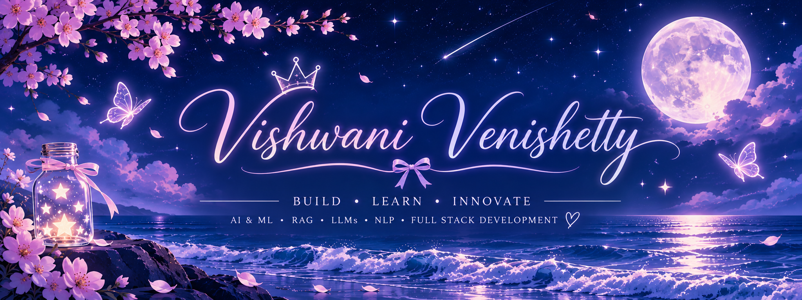

<!-- OCEAN BLUE GITHUB PROFILE README -->

  

  <b>Artificial Intelligence</b> &nbsp;•&nbsp;
  <b>Machine Learning</b> &nbsp;•&nbsp;
  <b>Full Stack Development</b>

---

## 🌊 About Me

- 🎓 Interested in Artificial Intelligence and Data Science.
- 🤖 Exploring Machine Learning, Deep Learning, NLP, RAG and LLMs.
- 💻 Building practical AI-powered applications and full-stack projects.
- 🧠 Interested in learning new technologies and solving real-world problems.
- 🚀 Always curious, always building, always improving.

---

## ⚓ Tech Stack

### Programming Languages

### AI / ML / Development

### Tools

---

## 🚀 Featured Projects

<table>
<tr>
<td width="50%">

### 📈 Demand Forecasting

Time-series-based demand forecasting using machine learning techniques.

</td>
<td width="50%">

### 💬 Sentiment Analysis

An NLP and machine learning project for analyzing sentiment in text.

</td>
</tr>
<tr>
<td width="50%">

### 🏫 Intelligent Resource Allocation

A DBMS-based resource management system featuring bookings and conflict detection.

</td>
<td width="50%">

### 🧪 More Projects Coming Soon

Continuously experimenting with new ideas, technologies and practical applications.

</td>
</tr>
</table>

---

## 🐬 Currently Exploring

- Retrieval-Augmented Generation (RAG)
- Large Language Models (LLMs)
- AI Agents and Generative AI
- Advanced NLP applications
- Full Stack Development

---

## 📊 GitHub Analytics

  

---

### 🌊 Explore. Experiment. Evolve.

*"Great things are built one line of code at a time."*

**Thanks for visiting my little corner of GitHub! 💙**

